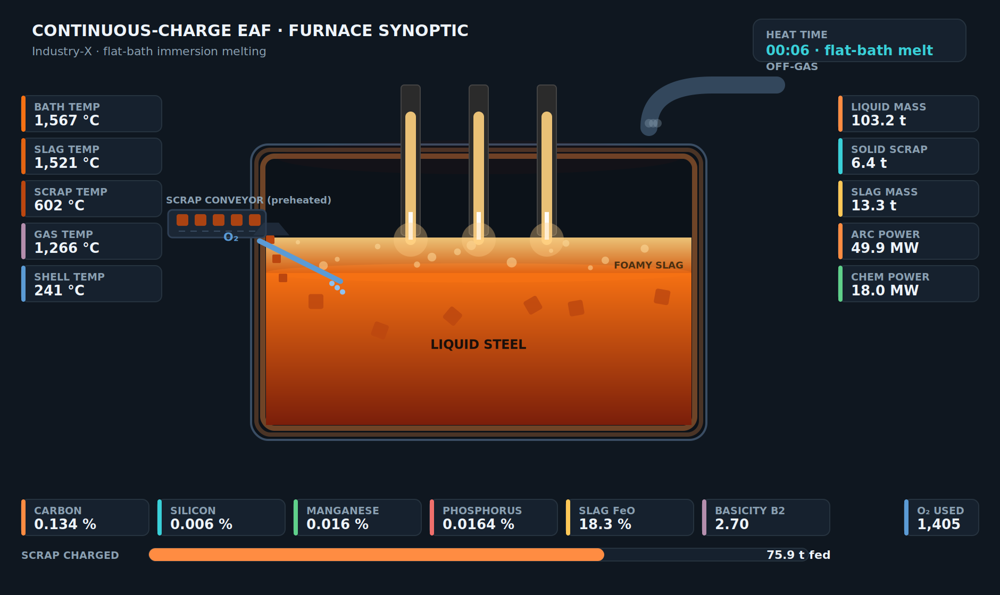

# Continuous-Charge (Consteel-type) EAF — Process Digital Twin

**Extractmet Private Limited**

A first-principles dynamic simulator for a **continuously-charged electric-arc
furnace** operating in flat-bath immersion-melting mode, delivered as an interactive
control-room HMI. The engine integrates coupled **mass and energy balances every
timestep** across the metal, slag, solid-scrap and freeboard-gas zones — with
oxidation thermochemistry, decarburisation kinetics, foamy-slag physics and
multilayer heat loss — and every headline KPI is validated against the peer-reviewed
literature.



---

## What's in this package

```
engine/         The validated first-principles engine (pure NumPy)
web/            Standalone browser HMI — open web/index.html (zero install)
streamlit/      Streamlit HMI + deployment files (Streamlit Community Cloud ready)
gui/            Native Tkinter desktop application
validation/     Figure/JSON generator + benchmark figures and sample heat
docs/           Mathematical model, user manual, validation report, help/FAQ
pitch/          Sales deck (.pptx), product datasheet (.pdf) and their generators
```

## Quick start

**Web console (nothing to install):**
open `web/index.html` in any modern browser.

**Streamlit HMI:**
```bash
cd streamlit && pip install -r requirements.txt && streamlit run streamlit_app.py
```

**Desktop app:**
```bash
cd gui && pip install numpy pandas matplotlib && python eaf_desktop.py
```
(Needs a Tk-enabled Python; `sudo apt install python3-tk` on Debian/Ubuntu.)

**Run the engine directly / regenerate figures:**
```bash
python engine/eaf_model.py
python validation/make_validation.py
```

## Documentation

- `docs/MATHEMATICAL_MODEL.md` — the full set of governing equations.
- `docs/USER_MANUAL.md` — how to configure and read each interface.
- `docs/VALIDATION.md` — benchmark scorecard and conservation results.
- `docs/HELP.md` — quick reference and FAQ.

## Validation at a glance

Every headline KPI sits inside its peer-reviewed literature window, and the model
conserves mass and energy to within ±1 %.

| KPI | Simulated | Window |
|-----|-----------|--------|
| Tap temperature | 1635 °C | 1600–1650 °C |
| Tap-to-tap time | 45.3 min | 40–60 min |
| Final carbon | 0.090 wt% | 0.05–0.10 wt% |
| Total energy demand | ≈564 kWh/t | ≈570 kWh/t |
| Productivity | 2.59 t/h/MW | 2.1–2.7 t/h/MW |
| Slag basicity B₂ | 2.02 | 1.8–2.5 |
| Slag FeO | 16.9 wt% | 12–25 wt% |
| Mass / energy closure | −0.6 % / 0.6 % | < ±1 % |

Benchmarked against Logar et al. (ISIJ 2012), Kirschen (Energy 2009/11),
Pretorius & Marr, Fruehan/DOE, and Zhang et al. (Metals 2026).

---

All plant identities are anonymised as **Industry-X**.

© Extractmet Private Limited. Model estimates are for engineering guidance and do
not constitute a guarantee of plant performance.
