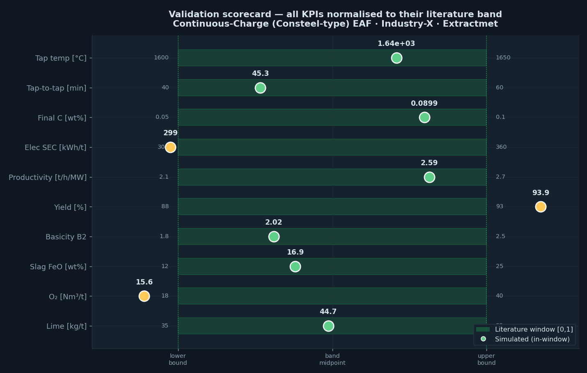

# Continuous-Charge (Consteel-type) EAF — Process Digital Twin

A first-principles dynamic simulator and interactive HMI for a **continuously-charged
electric-arc-furnace** operating in flat-bath immersion-melting mode (Consteel-type).
Built and maintained by **Extractmet Private Limited**.

The model integrates coupled **mass and energy balances every timestep** across the
metal, slag, solid-scrap and freeboard-gas zones, with oxidation thermochemistry and
kinetics (C, Si, Mn, P, Cr, Fe), FeO-driven decarburisation, foamy-slag physics,
post-combustion, multilayer refractory conduction and water-cooled-panel losses.
Every reported KPI sits inside the peer-reviewed literature window (see `VALIDATION.md`).



## Run locally

```bash
pip install -r requirements.txt
streamlit run streamlit_app.py
```

Then open the URL Streamlit prints (usually http://localhost:8501).

## Deploy on Streamlit Community Cloud

1. Push this `streamlit/` folder to a public GitHub repository (it is self-contained —
   `streamlit_app.py`, `synoptic.py` and `eaf_model.py` live side-by-side).
2. On https://share.streamlit.io, create a new app pointing at `streamlit_app.py`.
3. Streamlit installs `requirements.txt` and serves the app; the dark SCADA theme in
   `.streamlit/config.toml` is applied automatically.

## What's inside

| File | Purpose |
|------|---------|
| `streamlit_app.py` | Interactive HMI: KPI scorecard, live furnace synoptic (time-scrubber), static balance, dynamic trajectories, slag & chemistry, energy & mass balance, event log, data export. |
| `synoptic.py` | Self-contained SVG furnace cross-section reflecting the reactor state at any instant. |
| `eaf_model.py` | The validated first-principles engine (pure NumPy). |

## Using the HMI

* Configure the furnace in the sidebar (geometry, charge, fluxes, electrical,
  chemical, targets) and press **Run simulation**.
* The **Furnace synoptic** tab lets you scrub through the heat and watch every zone
  temperature, mass and chemistry value update live on the cross-section.
* The **Data** tab exports the full timestep-resolved trajectory (CSV) and a
  KPI + balance report (JSON).

All plant identities in the default configuration are anonymised as **Industry-X**.

---
© Extractmet Private Limited. For evaluation and pilot engagements, contact Extractmet.
